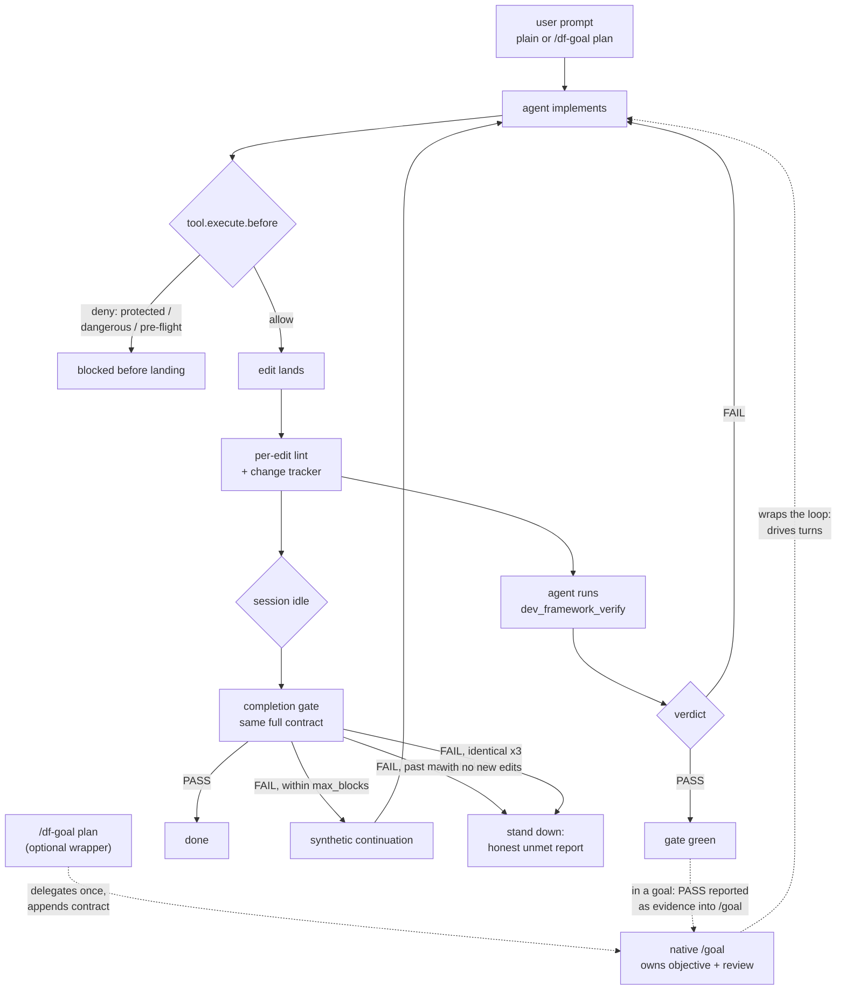

# opencode-dev-framework

An [OpenCode](https://opencode.ai) plugin that enforces project-specific
quality gates during AI coding sessions — and verifies whole tasks, not just
edits, through `/df-goal`. Inspired by
[anticomputer/dev-framework](https://github.com/anticomputer/dev-framework),
reimplemented as an OpenCode-native plugin.

## Quickstart

Five minutes from zero to your first gated session:

```bash
npm install opencode-dev-framework
```

```json
// opencode.jsonc
{
  "plugins": ["opencode-dev-framework"]
}
```

```bash
npx df init
```

`df init` auto-detects your language and writes a matching
`.opencode-dev-framework.yml`. Then start a session in your project and ask
the agent for a small edit. You will see the plugin working: the edit is
checked against guardrails before it lands, your linter runs on the edited
file, and when the session goes idle the completion gate runs your
typecheck/tests. `/df-status` shows the live state at any time. Start with
`profile: advisory` if you want to observe before enforcing.

Requires OpenCode `v2.x` — tested on `v2.0.26` and `v2.2.0`. On
`v1.18.18–1.18.31` use the `v1` branch (`plugin` key). Stuck? See
[`docs/user/troubleshooting.md`](docs/user/troubleshooting.md).

## What it does

- **Constitution injection.** Adds a project quality bar to the system prompt
  at session start (bundled default, overridable per project).
- **Guardrails.** Blocks or warns on protected paths (`.env`, vendored
  code, your own globs) and dangerous shell commands (`git push`, `rm -rf`).
- **Per-edit lint.** Runs your linter on each edited file and reports loudly.
- **Completion gate.** At the would-go-idle boundary, runs typecheck, tests,
  acceptance checks, and (optionally) lint on changed files — plus a required
  peer-review artifact in `standard`/`strict`. Failures steer the session
  back with the failure summary, bounded by `gate.max_blocks` (fewer when
  the failure repeats with no new edits — the gate stands down early on
  zero progress).
- **Verified goals (`/df-goal`).** Wraps a task in native `/goal` with a
  verification contract the reviewer weighs as evidence.
- **Pre-flight gate (optional).** Denies edits until the agent records
  required upfront research.
- **Custom tools + CLI.** `dev_framework_*` tools for in-agent use;
  `df init / profile / status / version` from the shell.

## Minimal configuration

```yaml
profile: standard

commands:
  typecheck: "npm run typecheck"
  test: "npm test"
```

Full reference (all keys, acceptance checks, pre-flight, rule overrides):
[`docs/user/configuration.md`](docs/user/configuration.md). Copy-paste
starters: [`examples/go-service/`](examples/go-service/).

## How it fits together

Every session runs the same loop — constitution, guardrails, lint, gate —
whether or not it starts under `/df-goal`. A goal just wraps that loop in
native verification:



## Profiles

| Profile    | Guardrails | Gate failures | Lint on edit | Pre-flight | Review required | Notes |
| ---------- | ---------- | ------------- | ------------ | ---------- | --------------- | ----- |
| `off`      | disabled   | not reported  | no           | no         | no              | Plugin registers no hooks at all. |
| `advisory` | warn       | warn          | yes          | warn only  | warned, not blocked | Nothing blocks; everything is logged. |
| `standard` | deny       | error         | yes          | deny edits | blocks completion | The default when a config file exists. |
| `strict`   | deny       | error         | yes          | deny edits | blocks completion | Also lints changed files in the gate. |

How each layer is enforced, and what it honestly cannot do:
[`docs/user/enforcement.md`](docs/user/enforcement.md).

## Commands

| Command | What it does |
| ------- | -------------- |
| `/df-status` | Instant modal: profile, guardrails, gate, configured commands. |
| `/df-runtime` | Instant modal: plugin version + live hook/gate runtime state. |
| `/df-help` | Instant modal: lists the dev-framework commands. |
| `/df-profile` | Instant modal picker (or `/df-profile <name>`): switches profile now, written to config. |
| `/df-verify` | Runs the verification suite manually; pass/fail summary in a modal. |
| `/df-goal <objective>` | Server-side command: starts a **verified** native goal (requires native `/goal`, a blocking profile, and at least one real check). |

The first five are TUI commands — they open instantly and never feed the
LLM. Full reference:
[`docs/user/commands.md`](docs/user/commands.md).

## Limitations (short version)

The completion gate **steers, it does not veto**: it continues the turn via a
synthetic message at the idle boundary (bounded by `gate.max_blocks` — fewer
when the failure repeats with no new edits), and you
can always close the session. A genuine pre-stop veto is proposed upstream
([`anomalyco/opencode#54487`](https://github.com/anomalyco/opencode/pull/54487),
open) — if it lands, the gate vetoes there instead of continuing. The
**pre-flight** gate is the one genuine hard block today. Guardrails add to OpenCode permissions, never replace them. Formatters
and linters are yours — the plugin runs them, it does not reimplement them.
Full story: [`docs/user/enforcement.md`](docs/user/enforcement.md).

## Troubleshooting

Duplicate plugin IDs, stale npm cache, TUI not loading, version matrix:
[`docs/user/troubleshooting.md`](docs/user/troubleshooting.md).

## Contributing

`AGENTS.md` is the canonical contributor contract. Build/test commands and
the release path: [`docs/dev/contributing.md`](docs/dev/contributing.md).

## Disclaimer

This plugin changes how an AI agent behaves in your repository. Review the
constitution, protected paths, and gate commands before enabling the
`standard` or `strict` profiles, and start with `advisory` if you want to
observe behavior without enforcement.

## License

MIT
