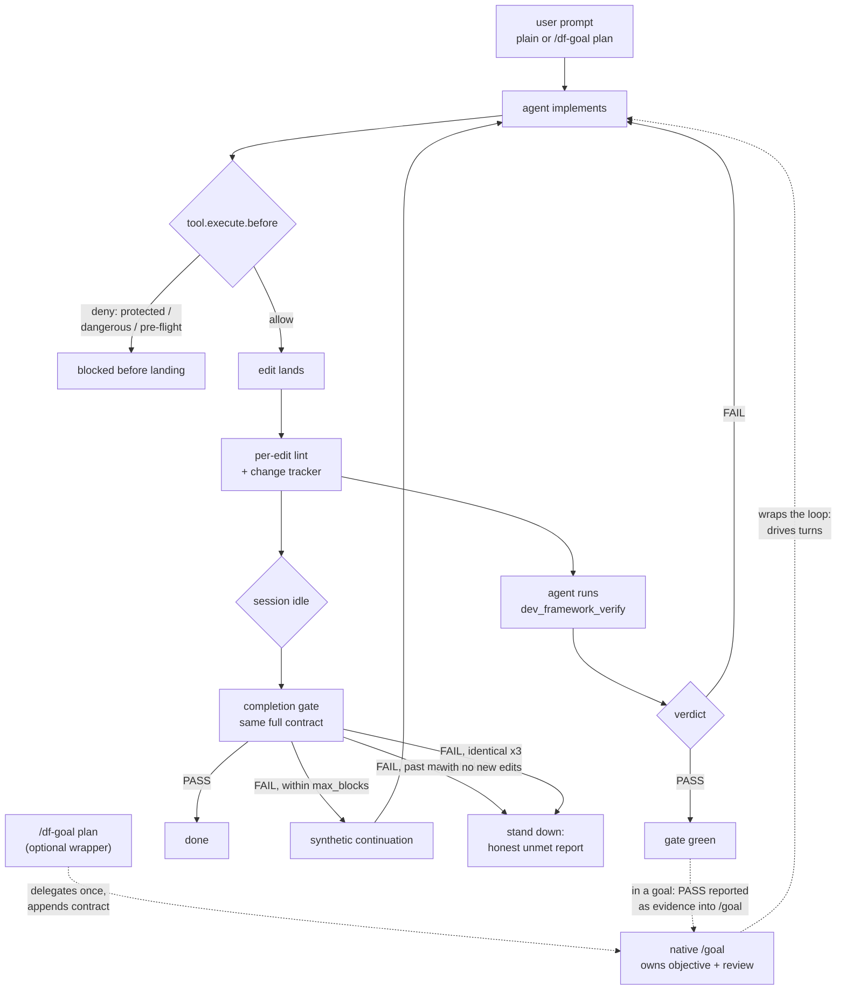

# Enforcement

How the plugin enforces on OpenCode `v2` (idle hook landed via
[`anomalyco/opencode#59437`](https://github.com/anomalyco/opencode/pull/59437)).

## Profiles

| Profile    | Guardrails | Gate failures | Lint on edit | Pre-flight | Review required | Notes |
| ---------- | ---------- | ------------- | ------------ | ---------- | --------------- | ----- |
| `off`      | disabled   | not reported  | no           | no         | no              | Plugin registers no hooks at all. |
| `advisory` | warn       | warn          | yes          | warn only  | warned, not blocked | Nothing blocks; everything is logged. |
| `standard` | deny       | error         | yes          | deny edits | blocks completion | The default when a config file exists. |
| `strict`   | deny       | error         | yes          | deny edits | blocks completion | Also lints changed files in the gate; per-edit lint failures are reported loudly (error level — the edit already landed, so nothing throws there). |

## Layers

| Mechanism | Primary layer | Backstop / fallback | Strength |
| --------- | ------------- | ------------------- | -------- |
| Pre-flight gate | `tool.execute.before` deny | — | **Hard block** on every build: the edit never lands. |
| Protected paths + dangerous commands | `tool.execute.before` deny/throw (load-bearing: the pipeline runs before-hooks first) | `permission.evaluate` native layer (deny) as defense-in-depth — it only ever sees calls the primary already passed; matters if core ever reorders the pipeline | **Hard block** via the primary deny; the native layer is belt-and-braces, never a weakening (it only denies or abstains). |
| Per-edit lint | `tool.execute.after` track + lint | `filesystem.changed` event (this release) | Report-only: the edit already landed, so failures log loudly but never throw. |
| Completion gate | `session.hook("experimental.idle")` (+ `idle` alias) → `session.synthetic` (same execution) | `event.subscribe` idle net for the boundaries the hook skips (deduped; synthetic-first, `prompt` fallback) | **Async, bounded** by `gate.max_blocks`. `/df-status` shows `Continuation (idle): active` once the hook has completed an evaluation, else the event-subscribe fallback. `execute.before` stays the only true hard wall. |

## Flow

npmjs.com does not render mermaid, so the README carries this same flow
as a plain-text diagram — update both together.

## Worked sessions

Three real runs against disposable fixtures show the loop end to end:

- [First gated session](sessions/first-gated-session.md) — the full loop
  on a green tree: constitution, per-edit lint, verify, idle gate.
- [Blocked gate, fix, pass](sessions/blocked-gate-fix.md) — a red tree
  blocks the session; the agent proves the failure, fixes, re-verifies.

## Limitations (read these)

- **The completion gate steers; it does not veto.** At the would-go-idle
  boundary the plugin admits a synthetic continuation in the same execution
  on failure inside `gate.max_blocks`; the event net covers the boundaries
  the hook skips. The user can always close the session — treat the gate as
  the strongest available enforcement, not an unbreakable lock. A pre-terminal
  vote hook is proposed upstream
  ([`anomalyco/opencode#54487`](https://github.com/anomalyco/opencode/pull/54487),
  open). The **pre-flight** gate, by contrast, is a genuine hard block on
  every build: it denies edit tools before the edit lands.
- **The gate stops spending budget on zero progress.** Three consecutive
  blocked evaluations with the identical failure and no new edits stand
  down early instead of burning the rest of `gate.max_blocks` — the
  continuation bought zero information twice, so the third stop reports
  the still-unmet requirement and ends. Any new edit or changed failure
  resets the streak; a PASS clears it entirely.
- **Guardrails run inside OpenCode.** `tool.execute.before` runs after
  OpenCode's own permission system; it adds project rules on top, it does
  not replace OpenCode permissions.
- **Formatting and linting are delegated.** The plugin runs the linter
  commands you declare; it does not reimplement formatters or linters.
  Formatting is OpenCode core's job — the plugin's `commands.format` /
  `on_edit.format` are accepted but ignored, deliberately not duplicated,
  and the plugin never rewrites your `opencode.json`.
